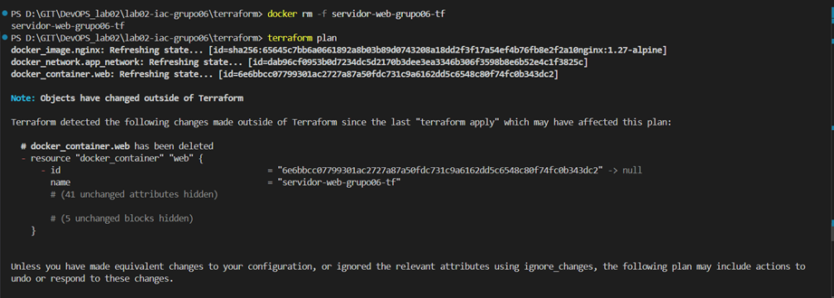
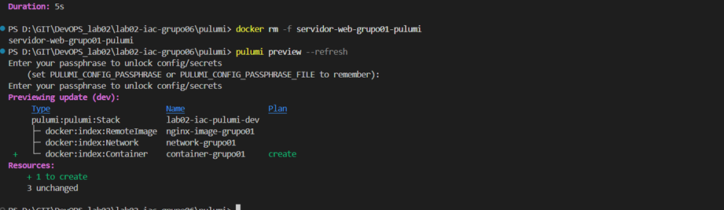
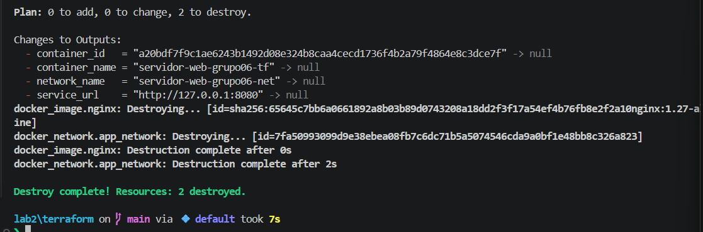
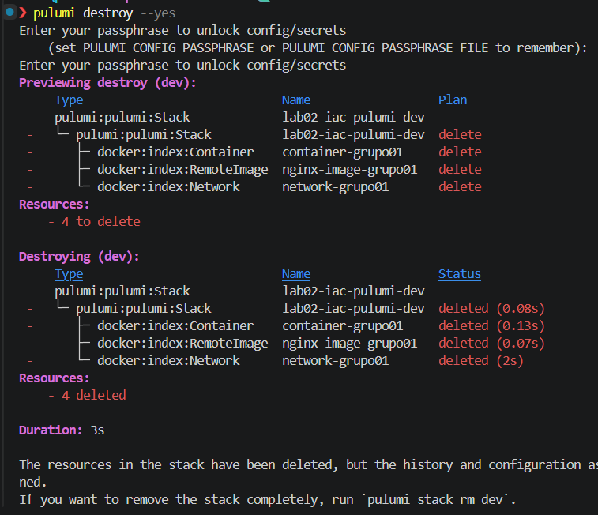
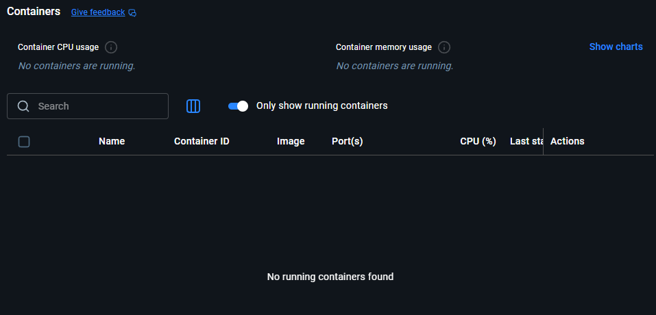

# Informe Comparativo IaC: Terraform vs. Pulumi
**Grupo:** grupo06  
**Integrantes:**  
- David Alfonso Cañas Palomino - R1 (Terraform)  
- Edgar Fernando Vega Morales - R2 (Pulumi)  
- Óscar Daniel Murillo Botero - R3 (Platform Lead)  

**Curso:** Fundamentos de DevOps y SRE – UNAL 2026-01 · **Laboratorio 02**

**Link del Repositorio:** https://github.com/F-DevOps-SRE/lab02-iac-grupo06 

**Arquitectura implementada (idéntica en ambas herramientas):** red Docker dedicada + imagen `nginx:1.27-alpine` + contenedor Nginx publicado en `127.0.0.1` (Terraform en `:8080`, Pulumi en `:8090`), con *labels* `managed-by`, `owner` y `tool` y variables de entorno `APP_ENV`, `MANAGED_BY` y `GROUP_ID`.

---

## 1. Matriz de Comparación Empírica

| Criterio de Comparación | Terraform (HCL) | Pulumi (Python) | Análisis del Grupo con Evidencia Observada |
|---|---|---|---|
| **1. Curva de aprendizaje y sintaxis** | DSL declarativo especializado (bloques `resource`, `variable`, `output`). | Lenguaje de propósito general (Python) con clases `docker.Network`, `docker.RemoteImage`, `docker.Container`. | HCL se lee como un archivo de configuración: cada bloque describe un recurso y no hay flujo de control que seguir. Lo más difícil fue la sintaxis de bloques repetidos (`labels { }` tres veces, `ports { }`, `networks_advanced { }`). En Pulumi la curva fue baja para el lenguaje, pero alta para el modelo de ejecución: hubo que entender `Output[T]` (por ejemplo, `pulumi.Output.concat` para `service_url`), las clases `*Args` del SDK y la preparación del entorno (`venv`, `pip install`, `pulumi login --local`, `stack init`). Terraform tuvo menos pasos para el primer `apply`: `init` → `plan` → `apply`. |
| **2. Líneas de código efectivas (LOC)** | **104 líneas** en 5 archivos `.tf` (`main.tf` 48, `variables.tf` 29, `outputs.tf` 16, `versions.tf` 9, `providers.tf` 2). | **56 líneas** en `__main__.py` (+ 6 en `Pulumi.yaml`, 6 en `Pulumi.dev.yaml` y 2 en `requirements.txt` = **70**). | Conteo sin comentarios, líneas en blanco ni el *docstring*. Pulumi usó aproximadamente un 33-46 % menos de líneas. La diferencia está en el *boilerplate*: cada variable de Terraform ocupa entre 5 y 10 líneas (`description`, `type`, `default`, `validation`), mientras que en Python una lectura de config con valor por defecto ocupa una línea (`config.get("groupId") or "grupo01"`). Además, los 4 outputs ocupan 16 líneas en HCL y 4 `pulumi.export` en Python. A cambio, la versión HCL documenta tipos y descripciones de forma explícita. |
| **3. Manejo del Estado (State)** | Archivo JSON `terraform/terraform.tfstate` dentro del proyecto. | Backend local en `~/.pulumi` (`pulumi login --local`), separado por *stack* (`dev`). | El `tfstate` es más fácil de inspeccionar: se abre con cualquier editor o con `terraform state list` / `terraform show`, y queda junto al código (por eso es obligatorio excluirlo en `.gitignore`). El estado de Pulumi vive fuera del repositorio y se consulta con `pulumi stack`, `pulumi stack output` o `pulumi stack export`. Además está ligado al concepto de *stack*, que facilita tener `dev`/`staging`/`prod`, y los secretos de configuración se cifran con *passphrase* (`encryptionsalt` en `Pulumi.dev.yaml`). Terraform es más transparente; Pulumi resuelve mejor la multiplicidad de ambientes. |
| **4. Validación de variables y tipos** | Bloque `validation { condition = contains([...], var.environment) }` y `type = number` / `string`. | Lógica en Python (`if environment not in valid_envs: raise ValueError(...)`) y `config.get_int("hostPort")`. | Terraform detecta el error **antes** de tocar Docker: en `terraform validate`/`plan` falla con el `error_message` personalizado (*"El ambiente debe ser 'dev', 'staging' o 'prod'."*) señalando el archivo y la línea de la variable. Pulumi detecta el error al **ejecutar** el programa durante `pulumi preview`: el mensaje propio aparece, pero envuelto en un *traceback* de Python, que es más ruidoso para quien no programa. A favor de Pulumi, la validación puede ser arbitrariamente compleja (regex, rangos, llamadas a funciones). Un detalle observado: `hostPort` se guarda como texto (`"8090"`) en el YAML y `get_int` lo convierte; si no es numérico, falla con error de tipo. Resultado: Terraform es más claro y declarativo; Pulumi es más flexible. |
| **5. Detección y corrección de Drift** | `terraform plan` (refresca el estado contra Docker **por defecto**). | `pulumi preview --refresh` (sin `--refresh`, confía en el estado guardado). | Al borrar el contenedor manualmente con `docker rm -f`, **ambas herramientas detectaron el drift** y propusieron recrear **solo** el contenedor (1 recurso a crear; la red y la imagen quedaron sin cambios). Terraform lo hizo sin bandera adicional y lo reporta explícitamente en la sección *"Objects have changed outside of Terraform"* (`docker_container.web has been deleted`). Pulumi necesita la bandera `--refresh` (o `pulumi refresh`): sin ella, `pulumi preview` informa que no hay cambios aunque el contenedor ya no exista. La corrección fue en ambos casos un `apply`/`up` normal. Ver sección 2. |
| **6. Multiplicidad y ciclos** | Meta-argumentos `count` / `for_each`. | Bucle estándar `for` (o *list comprehension*) en Python. | Para crear 10 réplicas, Terraform usa `count = 10` y la interpolación `count.index` en nombre y puerto, y se referencian como `docker_container.web[3]`. Pulumi usa un `for i in range(10):` normal, con nombres lógicos únicos (`f"container-{group_id}-{i}"`). Para casos simples ambas son legibles. En casos con lógica condicional o anidada (por ejemplo, réplicas distintas por ambiente) Python resulta más natural, mientras que en HCL se recurre a expresiones `for`, `dynamic` y condicionales ternarios, que se vuelven difíciles de leer. Ejemplos a continuación de la tabla. |
| **7. Ecosistema de Linters / Shift-Left** | `terraform fmt -check -diff`, `terraform init -backend=false`, `terraform validate`. | `ruff check .`, `flake8 . --select=E9,F63,F7,F82`. | Ambos *quality gates* están en `.github/workflows/iac-ci.yml` y corren en cada PR hacia `main`. El job de Terraform necesita descargar el CLI y el provider (`init`), así que su costo está en la red. El de Python solo instala `ruff` y `flake8` con `pip`, y `ruff` analiza el archivo en milisegundos (`ruff check .` → *All checks passed!*). Diferencia clave: `terraform validate` **entiende la infraestructura** (tipos de argumentos del provider, referencias entre recursos), mientras que `ruff`/`flake8` solo validan Python. Un argumento mal escrito en `docker.Container(...)` pasa el linter y solo falla en `pulumi preview`. Para un *shift-left* equivalente en Pulumi habría que añadir `pulumi preview` (con Docker disponible en el runner) o un *type checker* como `mypy`/`pyright`. |

### Ejemplos del criterio 6 (10 réplicas)

**Terraform (HCL):**

```hcl
resource "docker_container" "web" {
  count = 10
  name  = "${var.app_name}-${var.group_id}-tf-${count.index}"
  image = docker_image.nginx.image_id

  networks_advanced {
    name = docker_network.app_network.name
  }

  ports {
    internal = 80
    external = var.host_port + count.index # 8080..8089
    ip       = "127.0.0.1"
  }
}
```

**Pulumi (Python):**

```python
containers = [
    docker.Container(
        f"container-{group_id}-{i}",
        name=f"servidor-web-{group_id}-pulumi-{i}",
        image=image.image_id,
        networks_advanced=[docker.ContainerNetworksAdvancedArgs(name=network.name)],
        ports=[docker.ContainerPortArgs(internal=80, external=host_port + i, ip="127.0.0.1")],
    )
    for i in range(10)  # 8090..8099
]
```

---

## 2. Evidencias del Experimento de Drift

**Procedimiento:** Se hizo todo el proceso local en la maquina de trabajo de cada integrante.

### 2.1 Terraform



### 2.2 Pulumi



### 2.3 Comparación del comportamiento

| Aspecto | Terraform | Pulumi |
|---|---|---|
| Comando de detección | `terraform plan` | `pulumi preview --refresh` / `pulumi refresh` |
| ¿Refresca por defecto? | Sí | No (requiere `--refresh`) |
| Reporte del drift | Sección explícita *"Objects have changed outside of Terraform"* | Se refleja como `+ create` en el *diff* |
| Recursos afectados en el plan | Solo `docker_container.web` | Solo `container-grupo01` |
| Corrección | `terraform apply` | `pulumi up --refresh` |

---

## 3. Destrucción limpia ($0 residuos)

```text
$ cd terraform && terraform destroy -auto-approve
```


```
$ cd ../pulumi && pulumi destroy --yes
```



Ninguna de las dos herramientas dejó contenedores ni redes huérfanas. La imagen `nginx:1.27-alpine` permanece en el host porque ambas la declaran con `keep_locally = true`, lo cual es intencional para no volver a descargarla. Pulumi reporta 4 recursos porque cuenta el recurso `pulumi:pulumi:Stack`.



---

## 4. Conclusión Arquitectónica

**Pregunta:** si tuviéramos que desplegar una arquitectura de microservicios en una empresa donde todos los desarrolladores son de Python pero no saben DevOps, ¿qué herramienta elegiríamos y qué precauciones tomaríamos?

Elegiríamos **Pulumi con Python**. En este laboratorio la misma infraestructura ocupó 56 líneas efectivas de Python frente a 104 de HCL, y lo que más pesó fue que el equipo pudo reutilizar lo que ya sabe: funciones, bucles, *list comprehensions*, módulos, `pip` y los mismos linters (`ruff`, `flake8`) que usaría en cualquier otro proyecto Python. En una arquitectura de microservicios, donde se repite el mismo patrón (red, imagen, contenedor/servicio, puertos, etiquetas) para decenas de servicios, poder encapsularlo en una función o en un `ComponentResource` y llamarlo desde un `for` reduce la duplicación de forma más natural que `count`/`for_each`/`dynamic` en HCL. Además, el modelo de *stacks* (`dev`, `staging`, `prod`) da separación de ambientes desde el inicio y permite probar la infraestructura con `pytest`, algo que un equipo de Python adopta sin fricción.

Sin embargo, el experimento mostró los riesgos de dar un lenguaje de propósito general a un equipo sin experiencia en operaciones, así que tomaríamos estas precauciones:
1. **Detección de drift explícita.** Usar siempre `pulumi preview --refresh` / `pulumi up --refresh` en el pipeline (o `pulumi refresh` programado), porque a diferencia de `terraform plan`, Pulumi no detecta cambios externos por defecto.
2. **Shift-left real.** Agregar al CI, además de `ruff`/`flake8`, un *type checker* (`mypy`/`pyright`) y un `pulumi preview` obligatorio en cada PR, ya que los linters de Python no validan argumentos del provider como sí lo hace `terraform validate`.
3. **Validación en un solo lugar.** Centralizar la validación de configuración (por ejemplo, con `pydantic` o funciones propias), para no depender de `if/raise` dispersos que producen *tracebacks* poco amigables.
4. **Estado gestionado y bloqueado.** Mover el estado de `~/.pulumi` a un backend compartido con bloqueo (Pulumi Cloud, S3/Azure Blob/GCS) y cifrado de secretos.
5. **Disciplina declarativa.** Imponer por revisión de código que el programa solo **declare** recursos: nada de lógica con efectos secundarios, llamadas a APIs externas ni valores no deterministas (fechas, aleatorios) que generen *diffs* espurios.
6. **Gobernanza de ramas y componentes.** Mantener ramas protegidas con al menos una aprobación, como hicimos en este repositorio, y ofrecer componentes reutilizables mantenidos por un equipo de plataforma.

Terraform seguiría siendo una opción válida si la prioridad fuera la auditabilidad y la estandarización con equipos de operaciones externos, porque su DSL restringido hace más difícil escribir infraestructura "creativa".
